<div align="right">

**Ignition Heartbeat Monitor**
Date: 28. August 2026 · Page 1

</div>

---

# Concept

# Ignition Heartbeat Monitor
## OPC UA Heartbeat Client — Iteration 1

**Author:** Ghufran Uppal
**Project:** IgnitionHeartbeatMonitor
**Status:** Iteration 1 (Simple Console Solution)

---

### Document History

| Date | Version | Comment | Author |
| --- | --- | --- | --- |
| 28.08.2026 | 0.1 | Initial concept — simple console solution (connect, subscribe, print) | Ghufran Uppal |

---

## Table of Contents

- [Concept](#concept)
- [Ignition Heartbeat Monitor](#ignition-heartbeat-monitor)
  - [OPC UA Heartbeat Client — Iteration 1](#opc-ua-heartbeat-client--iteration-1)
    - [Document History](#document-history)
  - [Table of Contents](#table-of-contents)
    - [Figures](#figures)
    - [Tables](#tables)
  - [1 Introduction](#1-introduction)
    - [1.1 Document Purpose](#11-document-purpose)
    - [1.2 Glossary](#12-glossary)
  - [2 System Overview](#2-system-overview)
    - [2.1 Software Architecture](#21-software-architecture)
    - [2.2 Layered View](#22-layered-view)
    - [2.3 Data Flow](#23-data-flow)
    - [2.4 Repository Structure](#24-repository-structure)
  - [3 The Heartbeat Interface](#3-the-heartbeat-interface)
    - [3.1 Heartbeat Tags](#31-heartbeat-tags)
    - [3.2 Configuration](#32-configuration)
    - [3.3 Domain Contracts](#33-domain-contracts)
    - [3.4 Running the Application](#34-running-the-application)
  - [4 Non-Functional Requirements](#4-non-functional-requirements)
    - [4.1 OPC UA Version \& Connection](#41-opc-ua-version--connection)
    - [4.2 Security](#42-security)
    - [4.3 Startup Behaviour](#43-startup-behaviour)
    - [4.4 System Supervision](#44-system-supervision)
    - [4.5 Logging](#45-logging)
    - [4.6 Performance](#46-performance)
    - [4.7 Software Prerequisites](#47-software-prerequisites)
    - [4.8 Roadmap](#48-roadmap)
  - [5 Appendices](#5-appendices)
    - [5.1 Heartbeat Generation in Ignition](#51-heartbeat-generation-in-ignition)
    - [5.2 Sample Console Output](#52-sample-console-output)

### Figures

- Figure 1 — Software Architecture (Iteration 1)
- Figure 2 — Layered View
- Figure 3 — Data Flow Sequence

### Tables

- Table 1 — Glossary
- Table 2 — Architecture Legend
- Table 3 — Application Layers
- Table 4 — Configuration Settings
- Table 5 — Domain Contracts
- Table 6 — Supervision / Health Indicators
- Table 7 — Roadmap

---

## 1 Introduction

### 1.1 Document Purpose

This document describes the functionality of the **Ignition Heartbeat Monitor**, a lightweight C#
console application that verifies an [Ignition SCADA](https://inductiveautomation.com/) gateway is
alive and healthy.

Section [2](#2-system-overview) gives a system overview and the software architecture. Section
[3](#3-the-heartbeat-interface) describes the heartbeat interface, configuration, and how to run the
application. Section [4](#4-non-functional-requirements) defines the non-functional requirements.
Section [5](#5-appendices) contains supporting appendices.

> **Scope of Iteration 1.** This first iteration is intentionally simple: **connect → subscribe →
> print**. There is no cloud publishing, no database, and no certificate-based security. It provides
> a reliable, readable heartbeat on the console. Richer capabilities are planned in the
> [Roadmap](#48-roadmap).

### 1.2 Glossary

| Term | Meaning |
| --- | --- |
| **async / await** | C# language feature for non-blocking asynchronous operations. |
| **BAS** | Building Automation System. |
| **Channel** | An `System.Threading.Channels` queue used to decouple OPC UA callbacks from the consuming stream. |
| **Contract** | An interface or record that defines a boundary between components (see §3.3). |
| **DTO** | Data Transfer Object — an immutable object used only to carry data between layers (e.g. `TagValue<T>`, `HeartbeatEvent`). |
| **Gateway** | The Ignition SCADA server that hosts tags and the OPC UA server. |
| **Heartbeat** | A tag value the gateway increments on a fixed interval to prove it is alive. |
| **IAsyncEnumerable** | A .NET type representing an asynchronous stream of values, consumed with `await foreach`. |
| **Interface** | A C# contract (e.g. `ITagReader`) that declares members a class must implement, enabling loose coupling. |
| **Node ID** | An OPC UA address that uniquely identifies a tag on the server. |
| **OPC UA** | Open Platform Communications Unified Architecture — the industrial protocol used to read tags. |
| **opc.tcp** | The TCP transport scheme used by OPC UA endpoints. |
| **Pipeline** | The sequence of stages a reading passes through (read → validate → transform → publish). |
| **Record** | A C# reference/value type with value-based equality, used here for immutable DTOs. |
| **SCADA** | Supervisory Control and Data Acquisition. |
| **Session** | An OPC UA connection between client and server through which subscriptions are created. |
| **Subscription** | An OPC UA mechanism where the server pushes tag changes to the client. |
| **Tag** | A named data point in Ignition (e.g. `HeartBeat`). |

*Table 1 — Glossary*

---

## 2 System Overview

The Ignition Heartbeat Monitor connects to an Ignition gateway over **OPC UA**, subscribes to a
**heartbeat tag** that the gateway increments on a fixed interval, and prints every update to the
console in real time.

If updates keep arriving, the system is healthy. If they slow down or stop, the operator has an
early warning that something is wrong — a stalled gateway, a broken network path, or a failed
device.

For Iteration 1 there are just two moving parts: the **Ignition Gateway** (which produces the
heartbeat) and the **Heartbeat Monitor** console app (which reads and displays it). Both components
can run on the same computer or on different computers connected over the network.

### 2.1 Software Architecture

Figure 1 shows the software architecture of the Ignition Heartbeat Monitor.

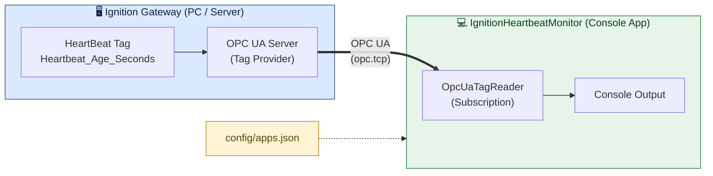

*Figure 1 — Software Architecture (Iteration 1)*

| Symbol / Style | Meaning |
| --- | --- |
| 🖥️ Blue box | PC / Server (Ignition Gateway host). |
| 💻 Green box | Console application (this project). |
| 🟨 Yellow box | Configuration file (`config/apps.json`). |
| `==>` thick arrow | OPC UA connection over `opc.tcp`. |
| `-.->` dashed arrow | Configuration loaded at startup. |

*Table 2 — Architecture Legend*

The console application reads its configuration from `config/apps.json` at startup and establishes
an OPC UA session to the gateway. Once connected, it creates a subscription and receives a push
notification each time the heartbeat tag changes. Every update is written to the console.

### 2.2 Layered View

Think of the application as a small building with three floors, each with a clear job. Someone on
one floor doesn't need to know how the others work — they just hand things up or down through a
well-defined “doorway.” In software, those doorways are called **interfaces**, and organising code
this way is known as a **layered approach**.

Why build it this way?

- **Easy to understand** — each part has one responsibility, so you can read one floor at a time.
- **Easy to change** — if the way we talk to the gateway changes, only one floor is affected; the
  others stay exactly the same.
- **Easy to grow** — future features (health checks, alerts, cloud) slot in as new rooms on an
  existing floor, without disturbing what already works.
- **Easy to test** — each floor can be checked on its own, even with a stand-in for its neighbours.

The three layers are shown in Figure 2. Each layer depends only on the one beneath it (through those
interface “doorways”), so a change in one place rarely ripples out to the rest.

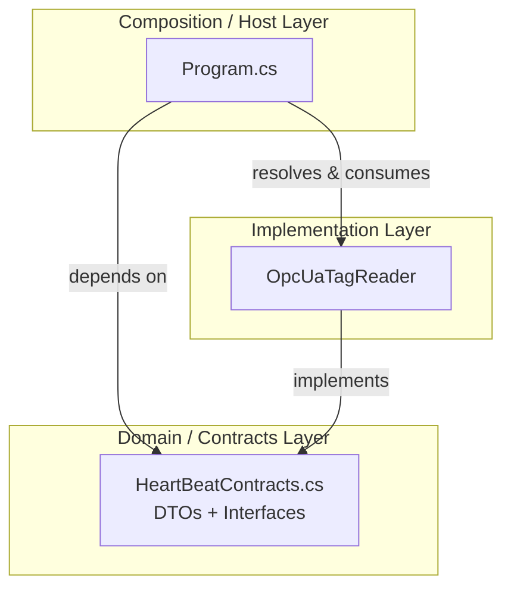

*Figure 2 — Layered View*

**1. Composition / Host layer — `Program.cs`**

The entry point and “wiring” of the application. It is deliberately thin and contains no OPC UA
details. Its responsibilities are:

- Load configuration from `config/apps.json` (via `IConfiguration`).
- Construct the reader (`OpcUaTagReader`) and use it through the `ITagReader` interface.
- Consume the update stream with `await foreach` and print each reading.
- Register a `Ctrl+C` handler and a `CancellationToken` so the app shuts down gracefully.
- Report first-message confirmation, errors, and a troubleshooting checklist when nothing arrives.

Because this layer talks only to interfaces, the underlying data source could later be swapped (for
example, a file-based or simulated reader) without touching orchestration logic.

**2. Domain / Contracts layer — `HeartBeatContracts.cs`**

The stable “language” of the system: the types every other layer agrees on. It has **no dependency**
on OPC UA or any transport, which keeps it easy to test and reuse. It contains:

- **DTOs** — immutable `record` types that carry data across boundaries:
  - `TagValue<T>` — a single reading (`NodeId`, `Value`, `ServerTimestamp`, `Quality`).
  - `HeartbeatEvent` — a validated, enriched result (used from Iteration 2 onward).
  - `HeartbeatState` — an enum classifying health (`Ok`, `Late`, `Stalled`, `BadQuality`).
- **Pipeline interfaces** — the seams for each processing stage:
  - `ITagReader` — *read* (implemented now).
  - `IValidator` — *validate* (future).
  - `ITransformer` — *transform* (future).
  - `IPublisher` — *publish* (future).

Defining these contracts up front fixes the *shape* of the pipeline so later iterations plug in
without redesign.

**3. Retrieval layer (Implementation layer) — `OpcUaTagReader`**

The concrete adapter to the outside world. It implements `ITagReader` and hides all OPC UA
mechanics from the rest of the app:

- Acts as the **retrieval (data-access) layer** — the *read* stage of the pipeline that fetches
  live tag values from the Ignition gateway.
- Establishes and validates the OPC UA `ApplicationConfiguration` and opens a `Session`.
- Creates a `Subscription` with `MonitoredItem`s for the configured Node IDs.
- Receives push notifications on UA callback threads and forwards them into a `Channel`, decoupling
  the UA threads from the consumer loop.
- Exposes readings as an `IAsyncEnumerable<TagValue<object>>` and cleans up the subscription and
  session in `DisposeAsync`.

Only this layer references the `Opc.Ua.*` libraries. If the transport changed, this is the single
place that would need to change.

**Why this matters**

Each future iteration (validation, transformation, publishing, cloud) adds a **new implementation of
an existing contract** rather than modifying the host. This keeps changes localised, makes each stage
independently unit-testable against its interface, and lets the pipeline grow without destabilising
what already works.

| Layer | File(s) | Responsibility | Depends on |
| --- | --- | --- | --- |
| Composition / Host | `Program.cs` | Configuration, wiring, output, lifecycle | Domain contracts |
| Domain / Contracts | `HeartBeatContracts.cs` | DTOs & pipeline interfaces | Nothing (pure) |
| Implementation | `OpcUaTagReader` | OPC UA session, subscription, streaming | Domain contracts, `Opc.Ua.*` |

*Table 3 — Application Layers*

### 2.3 Data Flow

Figure 3 shows the sequence of interactions from startup to steady-state monitoring.

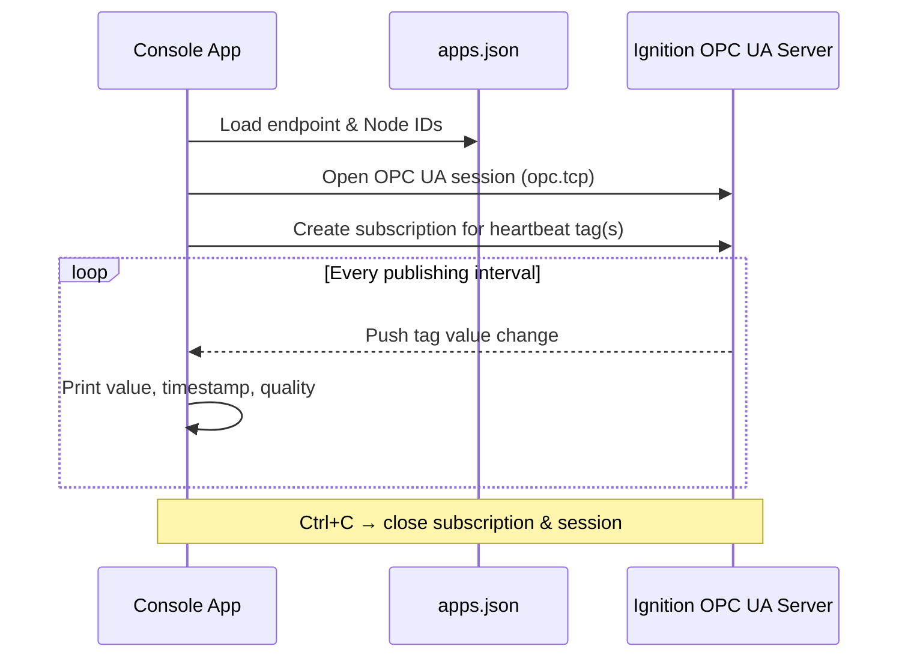

*Figure 3 — Data Flow Sequence*

1. The **Ignition Gateway** runs a timer script that increments the `HeartBeat` tag every second and
   updates `Heartbeat_Age_Seconds`.
2. The gateway exposes those tags through its built-in **OPC UA Server**.
3. On startup, the console app reads **`config/apps.json`** to learn the endpoint URL and which
   Node IDs to watch.
4. **`OpcUaTagReader`** opens an OPC UA session, creates a **subscription**, and receives a push
   notification every time a tag value changes.
5. Each update is printed to the **console** with its value, timestamp, and quality.

### 2.4 Repository Structure

```
IgnitionHeartbeatMonitor/
├── Readme.md
├── SECURITY_CONFIG.md
├── IgnitionHeartbeatMonitor.csproj
├── Program.cs
│
├── config/
│   ├── apps.json
│   └── apps.json.md
│
├── Ignition/                 # Setup screenshots (see Appendix 5.1)
│   └── HeartBeatTag*.png
│
└── src/
    ├── Implementation/
    │   └── opcUAReader.cs     # OpcUaTagReader (OPC UA subscription)
    │
    └── PipeLine/
        └── HeartBeatContracts.cs
```

---

## 3 The Heartbeat Interface

### 3.1 Heartbeat Tags

The application monitors one or two tags exposed by the Ignition gateway over OPC UA:

- **`HeartBeat`** — a counter the gateway increments on a fixed interval. A steadily changing value
  indicates a healthy gateway.
- **`Heartbeat_Age_Seconds`** *(optional)* — the number of seconds since the last heartbeat update.
  If configured, it is monitored alongside the main heartbeat tag.

Each tag reading is captured with its **value**, **server timestamp**, and **quality** indicator.

### 3.2 Configuration

The application is configured with the file `config/apps.json`. For Iteration 1 only the `OpcUa`
section is required — other sections are reserved for the [Roadmap](#48-roadmap) and are ignored.

```json
{
  "OpcUa": {
    "EndpointUrl": "opc.tcp://localhost:62541/discovery",
    "SecurityMode": "None",
    "SecurityPolicy": "None",
    "Username": "",
    "Password": "",
    "NodeIds": {
      "Heartbeat": "ns=1;s=[default]HeartBeat/HeartBeat",
      "HeartbeatAgeSeconds": "ns=1;s=[default]HeartBeat/Heartbeat_Age_Seconds"
    },
    "Subscription": {
      "Enabled": true,
      "PublishingIntervalMs": 1000,
      "SamplingIntervalMs": 1000,
      "QueueSize": 2
    }
  }
}
```

| Setting | Description |
| --- | --- |
| `EndpointUrl` | The `opc.tcp://` address of the Ignition OPC UA server. |
| `NodeIds:Heartbeat` | The Node ID of the heartbeat tag to monitor. |
| `NodeIds:HeartbeatAgeSeconds` | Optional. Age-in-seconds tag; monitored too if present. |
| `Subscription:PublishingIntervalMs` | How often (ms) the server pushes updates. |
| `Subscription:SamplingIntervalMs` | How often (ms) the server samples the tag. |
| `Subscription:QueueSize` | Number of samples buffered per monitored item. |

*Table 4 — Configuration Settings*

### 3.3 Domain Contracts

The code is organised around a small set of interfaces so it can grow cleanly in later iterations.
In Iteration 1 only `TagValue<T>` and `ITagReader` are used by the console flow; the remaining
contracts are placeholders for the [Roadmap](#48-roadmap).

Full documentation: **[HeartBeatContracts.md](src/PipeLine/HeartBeatContracts.md)**

| Contract | Used in Iteration 1? | Purpose |
| --- | --- | --- |
| `TagValue<T>` | ✅ Yes | A single tag reading (value, timestamp, quality). |
| `ITagReader` | ✅ Yes | Streams tag updates from OPC UA. |
| `HeartbeatState` | ⏳ Later | Health classification (Ok / Late / Stalled / BadQuality). |
| `HeartbeatEvent` | ⏳ Later | A validated, enriched heartbeat result. |
| `IValidator` | ⏳ Later | Decides if the heartbeat is healthy. |
| `ITransformer` | ⏳ Later | Shapes readings into events. |
| `IPublisher` | ⏳ Later | Sends events onward (console, HTTP, cloud). |

*Table 5 — Domain Contracts*

### 3.4 Running the Application

**Prerequisites**
- [.NET SDK](https://dotnet.microsoft.com/download) installed.
- An Ignition Gateway with a heartbeat tag exposed over OPC UA (see Appendix
  [5.1](#51-heartbeat-generation-in-ignition)).

**Steps**
1. Open `config/apps.json` and set `OpcUa:EndpointUrl` and the `NodeIds` to match your gateway.
2. From the project folder, build and run:
   ```bash
   dotnet run
   ```
3. Watch the console. A confirmation that the subscription is working is followed by a live stream
   of heartbeat updates (see Appendix [5.2](#52-sample-console-output)).
4. Press **Ctrl+C** to stop; the application closes the subscription and session cleanly.

> If no updates appear, the application prints a short checklist (endpoint reachable? Node IDs
> correct? network connectivity?) to help with troubleshooting.

---

## 4 Non-Functional Requirements

### 4.1 OPC UA Version & Connection

The application connects to the gateway using the **OPC UA** protocol over `opc.tcp`. The endpoint is
selected automatically from the configured `EndpointUrl`. If the gateway is unavailable at startup,
the connection attempt fails and a diagnostic message is printed.

### 4.2 Security

For Iteration 1 the application connects with **`SecurityMode = None`** and anonymous identity, which
is appropriate for lab and development environments. Certificate-based (PKI) security is **not** part
of this iteration and is planned for a later release; see **[SECURITY_CONFIG.md](SECURITY_CONFIG.md)**
for the intended security model.

### 4.3 Startup Behaviour

The application runs as a foreground console process. On startup it loads its configuration,
establishes the OPC UA session, and creates the subscription. It runs until interrupted with
**Ctrl+C**, at which point it shuts down gracefully.

### 4.4 System Supervision

The console output allows an operator to assess the system's health at a glance:

| Indicator | Meaning |
| --- | --- |
| Continuous `UPDATE` lines with `Good` quality | The gateway is healthy and reachable. |
| Updates stop or slow down | Possible stalled gateway, network issue, or failed device. |
| Non-`Good` quality flagged in colour | The tag value is questionable or bad. |
| Startup checklist printed | No messages received — connectivity or configuration problem. |

*Table 6 — Supervision / Health Indicators*

### 4.5 Logging

In Iteration 1, diagnostic output is written directly to the **console** with colour coding
(connection status, updates, warnings, and errors). Structured logging to files or external sinks is
planned for a later iteration.

### 4.6 Performance

The update rate is governed by the subscription's `PublishingIntervalMs` and `SamplingIntervalMs`
settings (default 1000 ms). A small queue size limits buffering. The workload is minimal — a single
subscription with one or two monitored items.

### 4.7 Software Prerequisites

- Windows (or any OS supported by .NET).
- .NET SDK (as targeted by `IgnitionHeartbeatMonitor.csproj`).
- OPC UA client libraries (`Opc.Ua.*`), restored via NuGet.
- An Ignition Gateway exposing the heartbeat tag over OPC UA.

### 4.8 Roadmap

Iteration 1 keeps things deliberately simple. Planned next steps, each a self-contained iteration:

| Iteration | Feature | Contracts Introduced |
| --- | --- | --- |
| **1 (in Progress)** | Connect, subscribe, print heartbeat to console | `TagValue<T>`, `ITagReader` |
| 2 | Health validation (Ok / Late / Stalled / BadQuality) | `IValidator`, `HeartbeatState` |
| 3 | Shape readings into structured events | `ITransformer`, `HeartbeatEvent` |
| 4 | Publish events (Console + HTTP endpoint) | `IPublisher` |
| 5 | Cloud publishing (Azure Event Hub / IoT Hub) & alerting | — |
| 6 | PKI-secured OPC UA (encrypted, trusted certificates) | — |

*Table 7 — Roadmap*

---

## 5 Appendices

### 5.1 Heartbeat Generation in Ignition

The following screenshots document how the heartbeat tag is created and exposed in Ignition.

**1. Create HeartBeat tag**
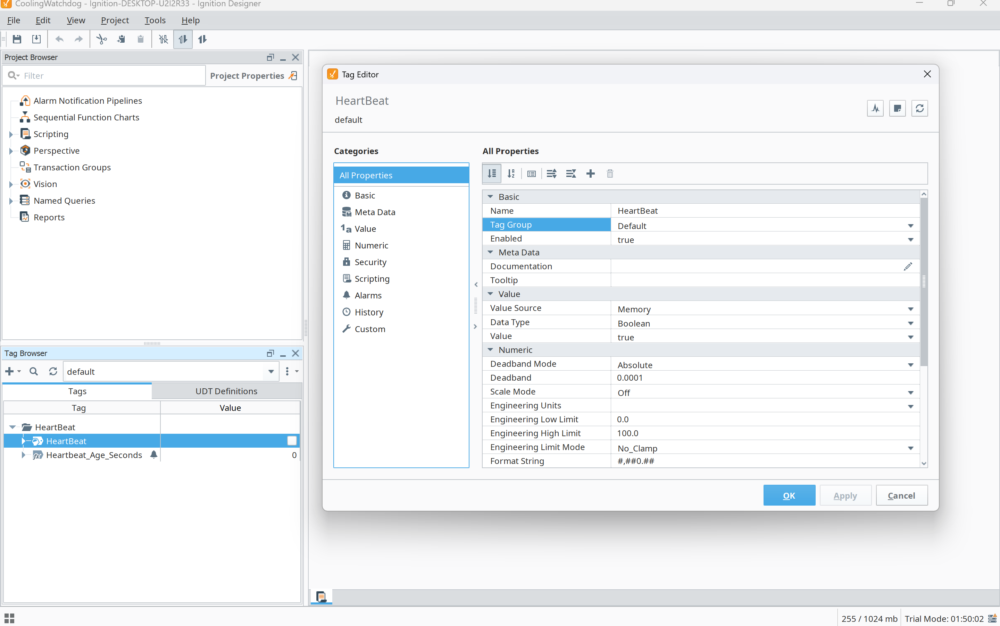

**2. Create Gateway Timer Script**
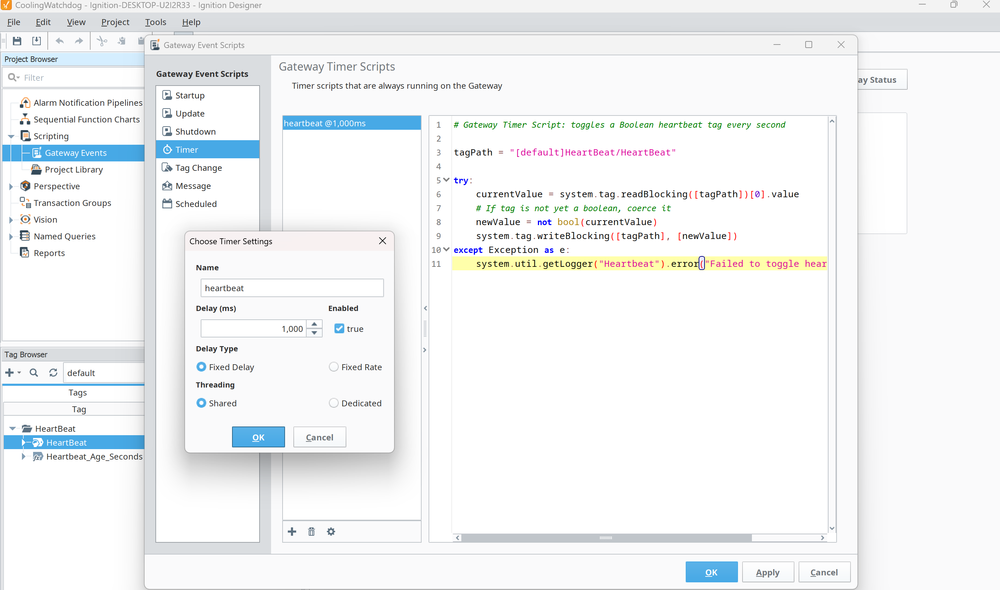

**3. Create Heartbeat_Age_Seconds**
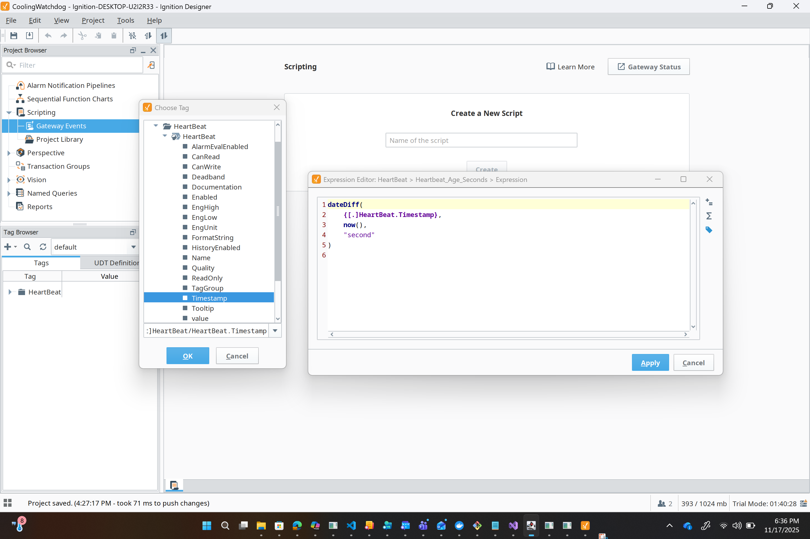

**4. Add Alarm Configuration**
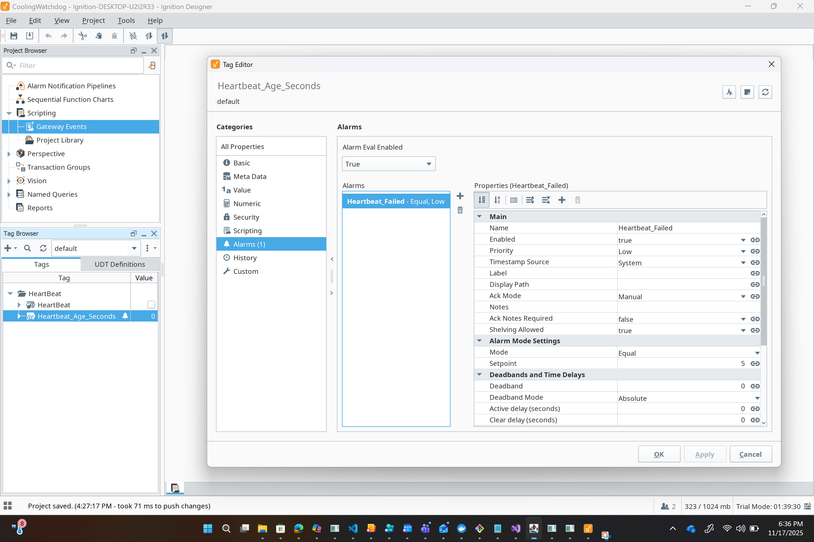

**5. Expose Tag Providers (OPC UA Settings)**
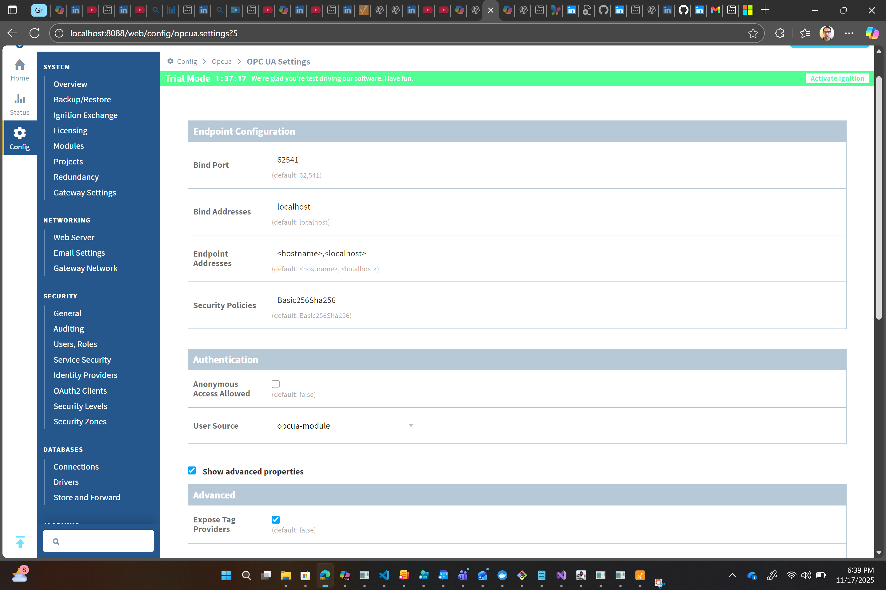

**6. Validate Tags via OPC Quick Client**
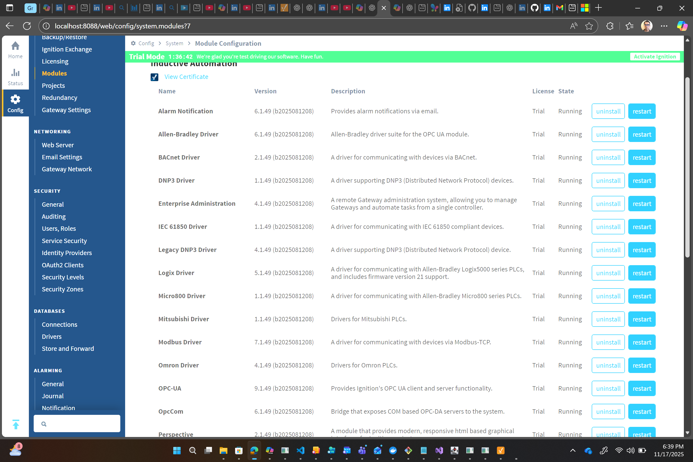

**7. Allow Anonymous Access (for testing)**
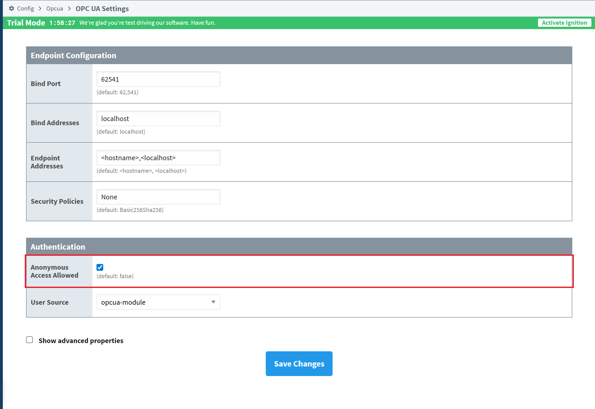

**8. Test Connection with Matrikon OPC UA Explorer**
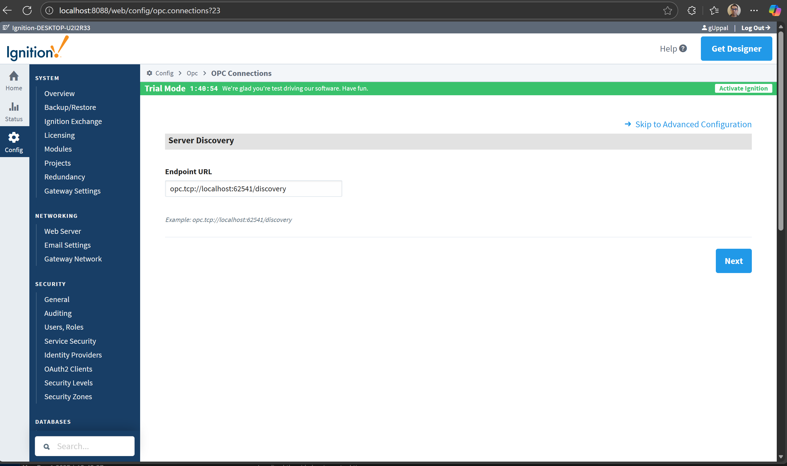
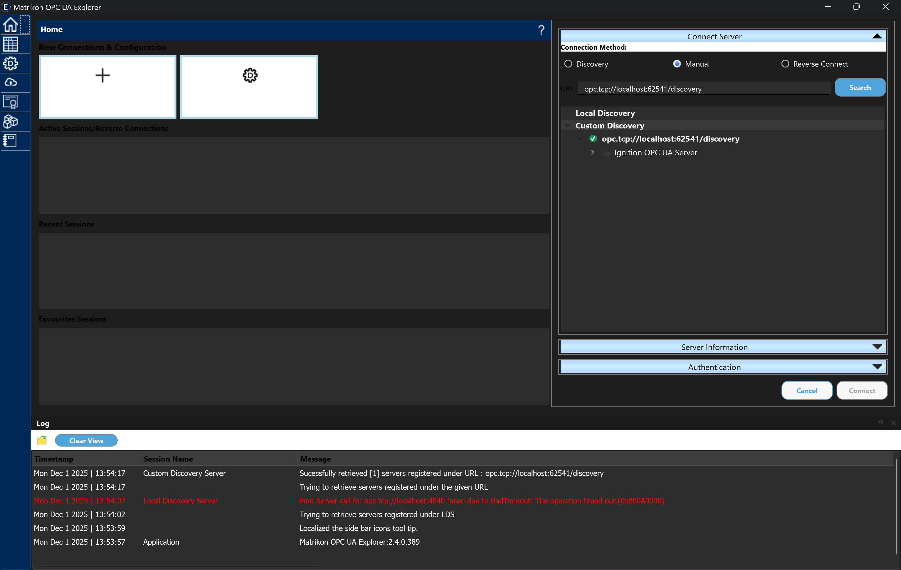
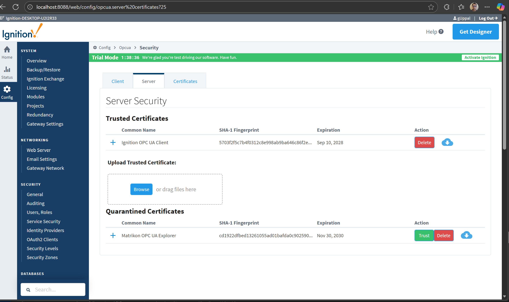
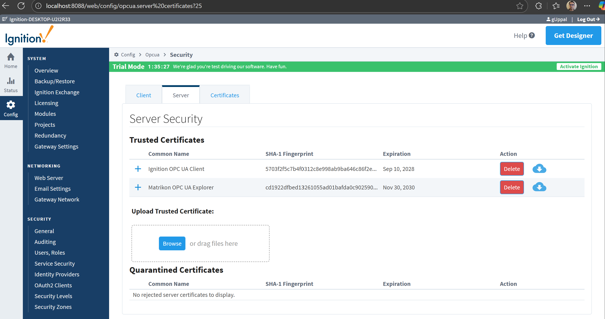
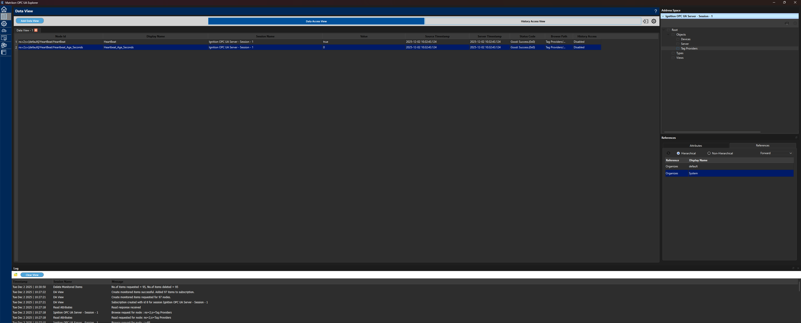

### 5.2 Sample Console Output

**Healthy stream** — updates arriving with `Good` quality:

```text
[OpcUaTagReader] Config = EndpointUrl: 'opc.tcp://localhost:62541/discovery'
[Reader] Connected to OPC UA endpoint: opc.tcp://localhost:62541/discovery
[Reader] OPC UA subscription created at 1000ms. Monitored 2 nodes.
[App] ✅ Subscription is working. We are receiving messages from the OPC UA server.
[Reader] UPDATE: node='...HeartBeat' value='42' ts='2026-08-28T14:03:01Z' quality='Good'
[Reader] UPDATE: node='...Heartbeat_Age_Seconds' value='0' ts='2026-08-28T14:03:01Z' quality='Good'
```

**Non-`Good` quality** — a reading arrives but its quality is questionable or bad (printed in
yellow). The value should not be trusted:

```text
[Reader] UPDATE: node='...HeartBeat' value='42' ts='2026-08-28T14:03:05Z' quality='Good'
[Reader] UPDATE: node='...HeartBeat' value='' ts='2026-08-28T14:03:06Z' quality='Bad'
[Reader] UPDATE: node='...HeartBeat' value='42' ts='2026-08-28T14:03:07Z' quality='Uncertain'
```

**Updates stop** — no messages are received (server unreachable, wrong Node IDs, or no network).
The application prints a troubleshooting checklist:

```text
[App] Starting subscription test…
[App] ⚠ No messages received from OPC UA server.
[App] Check:
[App]   1. Is the OPC UA server running at the configured endpoint?
[App]   2. Are the NodeIds in config/apps.json correct?
[App]   3. Do you have network connectivity to the server?
[App] Stopped.
```

**OPC UA error** — the connection or subscription fails outright:

```text
[App] ❌ OPC UA error: BadNotConnected
[App] Status Code: BadNotConnected
```
